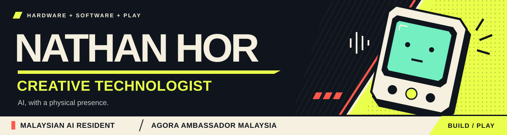
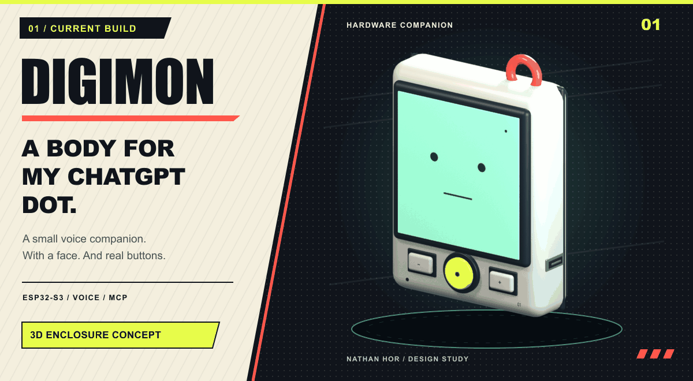
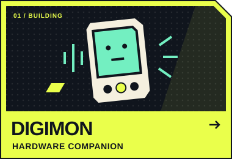
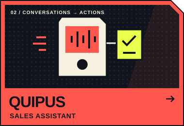
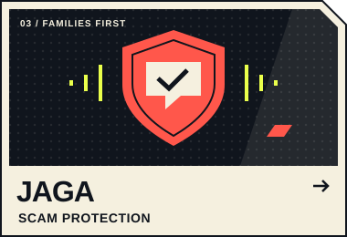
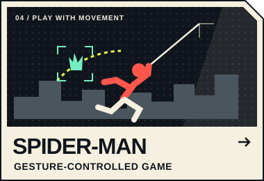
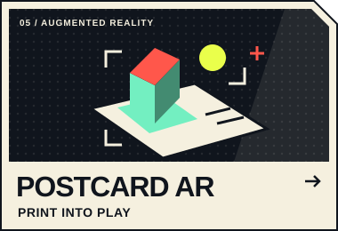
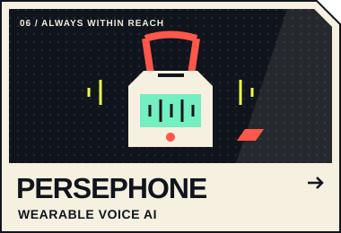

  <a href="#current-builds"><strong>CURRENT BUILDS</strong></a> &nbsp; / &nbsp;
  <a href="#project-roster"><strong>PROJECT ROSTER</strong></a> &nbsp; / &nbsp;
  <a href="#achievements"><strong>ACHIEVEMENTS</strong></a> &nbsp; / &nbsp;
  <a href="#loadout"><strong>LOADOUT</strong></a>

I'm **Nathan**, a creative technologist and agentic AI developer in Malaysia. I build AI you can talk to, hardware you can hold, and games you control with your body. I like working on the details that make an interaction feel right: a responsive gesture, a well-timed blink, a useful next step.

**Malaysian AI Resident** · **[Agora Ambassador Malaysia](https://www.agora.io/en/)**

Right now, most of my attention goes into **Quipus**, my sales assistant, and **Digimon**, a physical companion for my ChatGPT dot.

## Current builds

### 01 / Digimon

A small voice companion for my existing **ChatGPT dot**. I'm building its physical presence around an ESP32-S3: a mint face, blinking eyes, a mouth that follows audio, and buttons for recording, volume and microphone mute.

**ESP32-S3 · C · ESP-IDF · OpenAI · MCP**

[Explore the code ↗](https://github.com/NathanHor22/digimon) · [Firmware UI](https://github.com/NathanHor22/digimon/blob/main/preview.png) · [Build notes](https://github.com/NathanHor22/digimon/blob/main/BUILD_REPORT.md) · [Still image](./assets/digimon-still.png)

The animation is an original enclosure design study, not footage of the device. Firmware builds and local checks pass; live device-to-dot voice verification is still pending.

## Project roster

**Pick a project to open its repository.** Hardware companions, agentic applications and experiments in play.

<table>
  <tr>
    <td width="33%" valign="top">
      
      
<a href="https://github.com/NathanHor22/digimon"><strong>Digimon</strong></a> A physical companion for my ChatGPT dot.

      ESP32-S3 · ESP-IDF · OpenAI
    </td>
    <td width="33%" valign="top">
      
      
<a href="https://github.com/NathanHor22/Quipus"><strong>Quipus</strong></a> From business conversations to useful follow-ups.

      ESP32-S3 · Next.js · Agora
    </td>
    <td width="33%" valign="top">
      
      
<a href="https://github.com/NathanHor22/codex-hackathon"><strong>Jaga</strong></a> Multilingual scam checks over text, voice and Telegram, with an ESP32 guardian prototype for elderly users.

      Next.js · Agora · ElevenLabs
      
<a href="https://jagacare.vercel.app/">Try Jaga ↗</a>

    </td>
  </tr>
  <tr>
    <td width="33%" valign="top">
      
      
<a href="https://github.com/NathanHor22/spiderman-mediapipe-game"><strong>Spider-Man</strong></a> Hold a “thwip” pose. Fire a web. Swing using your webcam.

      Python · Panda3D · MediaPipe
    </td>
    <td width="33%" valign="top">
      
      
<a href="https://github.com/NathanHor22/postcardAR"><strong>Postcard AR</strong></a> A WebAR postcard for a US Embassy cultural activation.

      ZapWorks · Three.js · WebAR
      
<a href="https://nathanhor22.github.io/postcardAR/">Open experience ↗</a>

    </td>
    <td width="33%" valign="top">
      
      
<a href="https://github.com/jinchuntan/whisp"><strong>Persephone</strong></a> A palm-sized AI e-lanyard, from microcontroller to voice.

      ESP32-S3 · C/C++ · Voice AI
    </td>
  </tr>
</table>

Jaga and Persephone are team projects with <a href="https://github.com/jinchuntan">Nigel Tan</a>. Roster artwork represents each project's idea.

<strong>Side quests — more projects &amp; experiments</strong>

| Project | What I explored |
| :--- | :--- |
| **Jungle Flight** | Fly a 3D bird by flapping your arms; lean to steer. Python, Panda3D, MediaPipe. |
| **Catch the Falling Durian** | A body-tracked arcade booth game with Kinect and touchscreen input. Python, Pygame, C#. |
| **[Hand Slingshot](https://github.com/NathanHor22/Slingshot-hand-gesture-game)** | Hand gestures drive aim and release. Python, Pygame, MediaPipe. |
| **Sunday** *(in development)* | A local-first Android engineering companion with voice interaction. Kotlin, TypeScript. |
| **[Tenun](https://tenun.vercel.app)** | Career pathways for Malaysian students and fresh graduates. React, TypeScript, LLM agents. |
| **[Game UX Summit 2026](https://github.com/NathanHor22/gameuxwebsite)** | A responsive event website with speakers and registration. React, Tailwind CSS. |

## Achievements

| Result | Event |
| :--- | :--- |
| 🥇 **1st Place** | AWE 2026 Pacific Portal — XR AR Track |
| 🏆 **Winner** | AISEA 1$ Sprint Hackathon |
| 🥉 **3rd Place** | OpenAI Community Codex Hackathon |
| **Top 5 Finalist** | Agentic AI Build Week, Vietnam |
| **Top 3 Finalist** | Loveable Hackathon — Healthcare Operations Track |

## Loadout

| What I'm building | Tools I reach for |
| :--- | :--- |
| **AI &amp; voice** | Python · OpenAI · LLM agents · MCP · Agora · ElevenLabs |
| **Physical interfaces** | ESP32-S3 · ESP-IDF · C/C++ · Arduino |
| **Web &amp; mobile** | React · Next.js · TypeScript · Tailwind CSS · Kotlin · Supabase |
| **Interactive experiences** | MediaPipe · OpenCV · Panda3D · Pygame · Three.js · Unity · Unreal Engine |

---

  <strong>Got something interesting to build?</strong> 
  Hardware companions, agentic applications, or playful interfaces.  
  <a href="https://www.linkedin.com/in/nathan-hor-99a27a205/"><strong>LET'S CONNECT ↗</strong></a>

